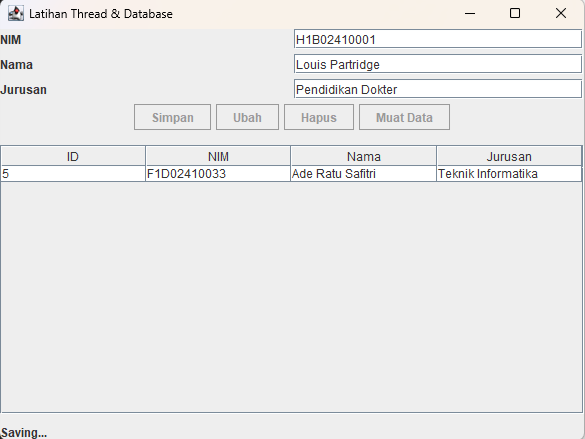
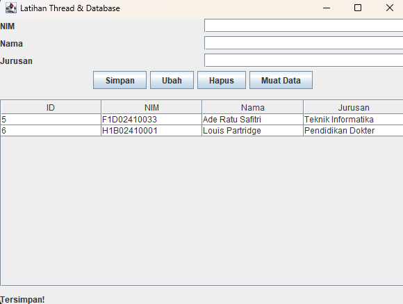

# Latihan Thread dan Database pada Java
## Nama: Ade Ratu Safitri
## NIM: F1D02410033

Case study untuk materi **Thread** dan **Database** pada Java. Aplikasi ini adalah CRUD data mahasiswa berbasis GUI Swing yang terhubung ke MySQL lewat JDBC. Semua operasi database dijalankan di thread terpisah supaya tampilan tidak membeku.

## Teknologi

- Java (JDK 25)
- Swing (GUI)
- MySQL 8.4 (Laragon)
- MySQL Connector/J (JDBC driver)
- VS Code + Extension Pack for Java
- HeidiSQL untuk mengelola database

## Struktur Project

```
latihan-thread-database/
├── lib/
│   └── mysql-connector-j-x.x.x.jar
├── src/
│   ├── App.java             # tes koneksi dan CRUD lewat console
│   ├── Mahasiswa.java       # model data
│   ├── MahasiswaDAO.java    # akses database (CRUD)
│   └── MahasiswaGUI.java    # tampilan GUI + penerapan thread
└── README.md
```

## Cara Menjalankan

1. Jalankan **Laragon**, klik **Start All**, pastikan MySQL menyala.
2. Buat database `latihan-thread-database_db` di HeidiSQL, lalu jalankan query berikut:

   ```sql
   CREATE TABLE mahasiswa (
       id INT AUTO_INCREMENT PRIMARY KEY,
       nim VARCHAR(20) NOT NULL,
       nama VARCHAR(100) NOT NULL,
       jurusan VARCHAR(50)
   );
   ```

3. Letakkan file `mysql-connector-j-x.x.x.jar` di folder `lib`, lalu pastikan jar tampil di **Java Projects → Referenced Libraries**. Bisa juga lewat `.vscode/settings.json`:

   ```json
   {
     "java.project.referencedLibraries": ["lib/**/*.jar"]
   }
   ```

4. Sesuaikan `URL`, `USER`, dan `PASS` di `MahasiswaDAO.java` bila konfigurasi databasemu berbeda. Default Laragon: user `root`, password kosong, port `3306`.
5. Jalankan `MahasiswaGUI.java` (tombol **Run Java** di pojok kanan atas editor).

## Penerapan Materi

### 1. Database (DAO)

`MahasiswaDAO` memisahkan logika database dari tampilan.

| Operasi | Method | Teknik |
|---------|--------|--------|
| Create | `insert()` | `PreparedStatement` |
| Read | `getAll()` | `PreparedStatement` + `ResultSet` |
| Update | `update()` | `PreparedStatement` + transaction (commit/rollback) |
| Delete | `delete()` | `PreparedStatement` + transaction (commit/rollback) |

Koneksi dibuat lewat `DriverManager.getConnection()` dan ditutup otomatis dengan `try-with-resources`.

### 2. Pola Thread: DB di Thread → invokeLater → GUI

Operasi database bisa memakan waktu. Kalau dijalankan di Event Dispatch Thread (EDT), GUI akan membeku. Karena itu alurnya:

1. **Click handler** dijalankan di EDT: tombol dinonaktifkan dan label berubah menjadi `Saving...`.
2. **Proses database** dijalankan di `new Thread(...)`.
3. Setelah selesai, hasilnya dikirim kembali ke EDT lewat `SwingUtilities.invokeLater(...)` untuk memperbarui tabel, label, dan mengaktifkan tombol lagi.

Pola ini ada di method `jalankan()` pada `MahasiswaGUI.java`, dan dipakai oleh semua tombol (Simpan, Ubah, Hapus, Muat Data).

### 3. GUI dan Thread

Contoh pada tombol **Simpan**:

- Klik tombol → tombol dinonaktifkan → label menampilkan `Saving...`
- Data disimpan ke database di thread terpisah
- Selesai → label menjadi `Tersimpan!` → tombol aktif kembali

Catatan: ada `Thread.sleep(1000)` di method `jalankan()` yang hanya dipakai untuk simulasi proses lama agar label `Saving...` sempat terlihat saat demo.

## Fitur

- Tambah data mahasiswa (NIM, nama, jurusan)
- Tampilkan data dalam tabel
- Ubah data (pilih baris di tabel, edit form, klik **Ubah**)
- Hapus data (dengan dialog konfirmasi)
- Validasi input: NIM dan Nama wajib diisi
- Status proses ditampilkan lewat label di bagian bawah jendela

## Screenshot

**Saat proses menyimpan (`Saving...`, tombol nonaktif)**



**Setelah data tersimpan (`Tersimpan!`)**

